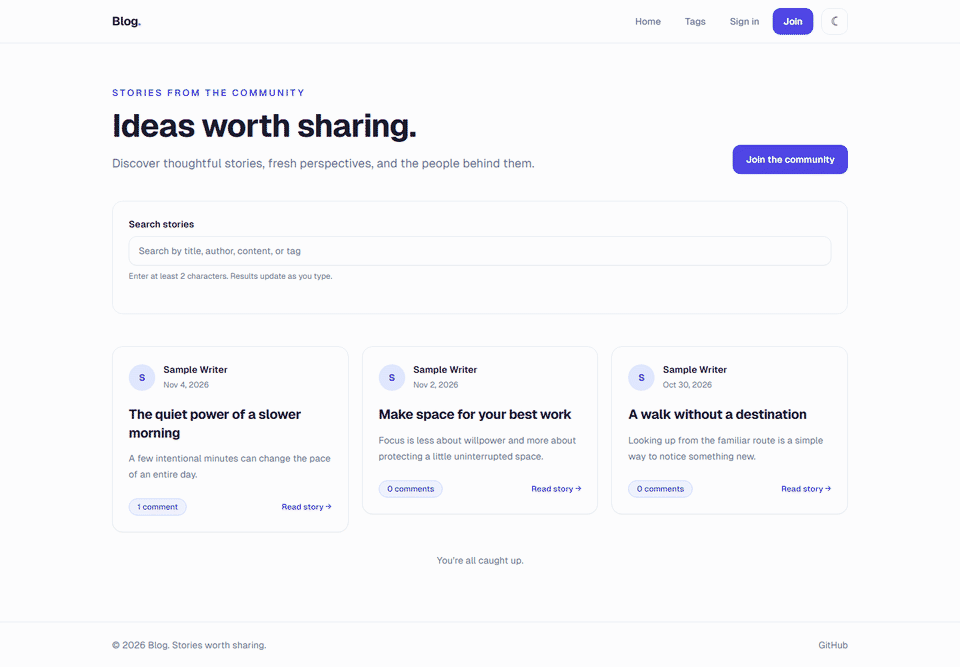
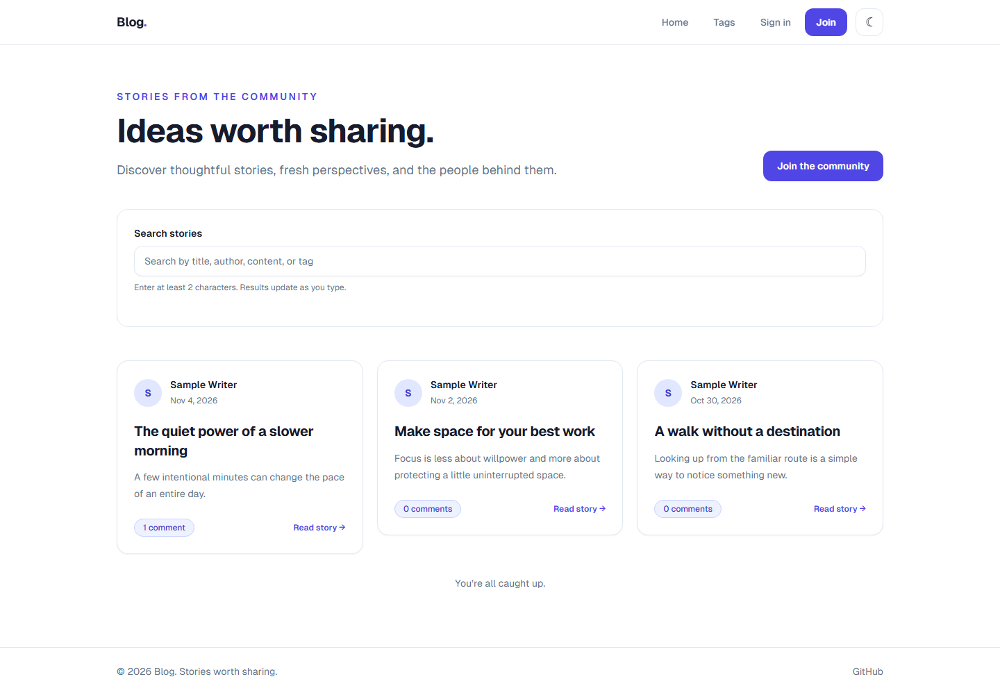
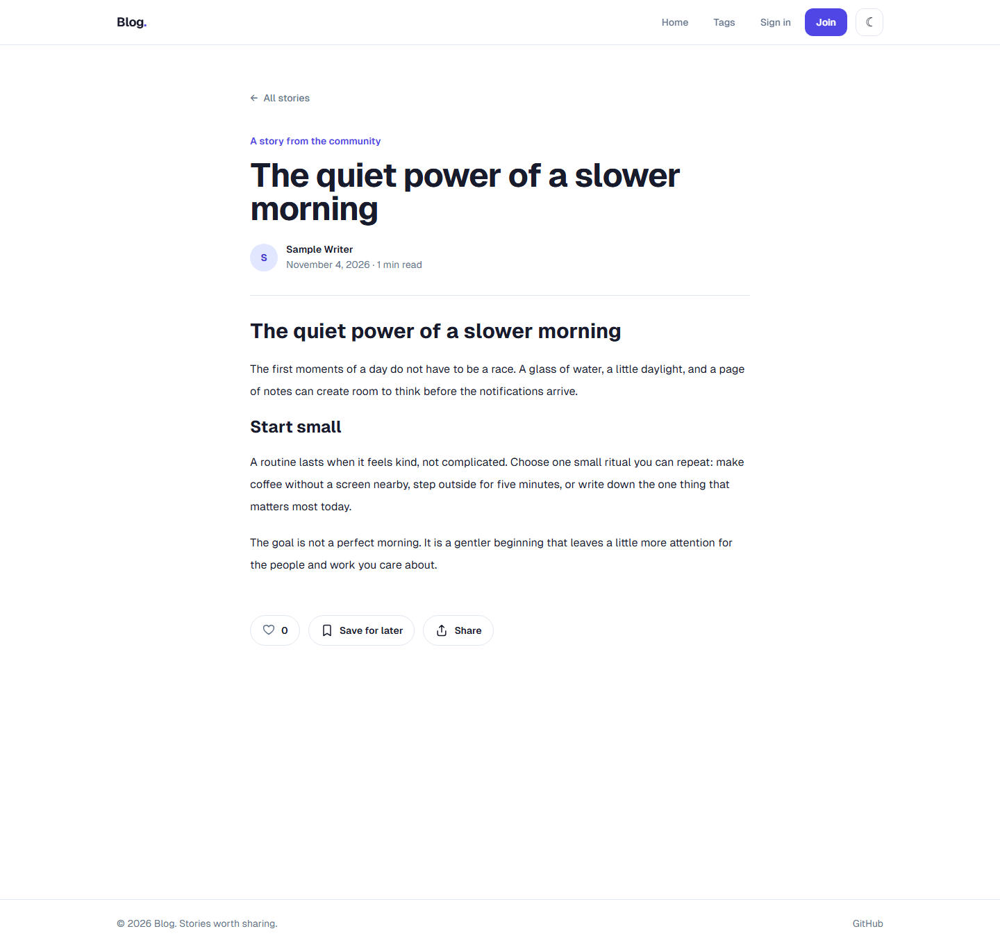

# Blog — Stories Worth Sharing

A modern, full-stack blogging platform built with **Next.js (App Router)**, **TypeScript**, **Tailwind CSS**, **Prisma ORM**, and **MongoDB**. Designed with a 3-column feed architecture, rich Markdown writing workspace, nested discussions, and reader engagement features.

---

## 📸 Product Preview



### Home Feed & Discovery



### Reading & Discussion Experience



---

## ✨ Features

- **3-Column Medium-style Layout:** Left navigation sidebar, center infinite-scroll feed with category tabs, and right-hand discovery panel with trending tags.
- **Rich Markdown Workspace:** Live split-pane writing environment with syntax highlighting (`rehype-highlight`), GFM support (`remark-gfm`), word counting, and local draft autosave.
- **Nested Comments & Discussions:** Multi-level comment and reply threads with optimistic UI updates.
- **Engagement System:** One-click story liking with floating particle animations and a personal reading list (bookmarks).
- **Instant Search:** Debounced full-text search across story titles, excerpts, content, tags, and authors with case-insensitive matching.
- **Reading Comfort:** Estimated read time calculations, top navigation progress bar, and system-aware dark/light theme switching.
- **Author Profiles & Story Dashboard:** Dedicated author pages, story draft/publish state management, and profile customization.
- **Robust Security & Data Integrity:** Bcrypt password hashing, session-based JWT authentication via NextAuth.js, and Zod runtime schema validation.

---

## 🛠️ Tech Stack

| Category           | Technology                                                                                            |
| ------------------ | ----------------------------------------------------------------------------------------------------- |
| **Framework**      | [Next.js 16](https://nextjs.org/) (App Router, Server Components & Route Handlers)                    |
| **Language**       | [TypeScript 5](https://www.typescriptlang.org/) (Strict Mode)                                         |
| **Styling**        | [Tailwind CSS 3](https://tailwindcss.com/) & [Framer Motion](https://www.framer.com/motion/)          |
| **Database & ORM** | [MongoDB](https://www.mongodb.com/) via [Prisma 6](https://www.prisma.io/)                            |
| **Authentication** | [NextAuth.js 4](https://next-auth.js.org/) (Credentials Provider, JWT Strategy)                       |
| **Validation**     | [Zod 3](https://zod.dev/)                                                                             |
| **Markdown**       | [React Markdown](https://github.com/remarkjs/react-markdown), `rehype-highlight`, `remark-gfm`        |
| **Testing**        | [Vitest](https://vitest.dev/) (Unit/Integration) & [Playwright](https://playwright.dev/) (End-to-End) |
| **Code Quality**   | ESLint, Prettier, Husky, lint-staged                                                                  |

---

## 📁 Project Structure

```text
├── prisma/
│   ├── schema.prisma       # Prisma schema configured for MongoDB
│   └── seed.ts             # Database seeding script for sample authors and stories
├── public/
│   ├── demo.gif            # Product demo recording
│   └── screenshots/        # Application UI screenshots
├── src/
│   ├── app/                # Next.js App Router (pages and API endpoints)
│   │   ├── api/            # REST API endpoints (posts, comments, likes, search, profile)
│   │   ├── authors/[id]/   # Author profile and stories view
│   │   ├── bookmarks/      # Saved reading list page
│   │   ├── dashboard/      # Writer's workspace & story management
│   │   ├── posts/[slug]/   # Individual story reading experience
│   │   ├── tags/           # Tag exploration & tag detail pages
│   │   ├── write/          # Markdown story creator and editor
│   │   └── page.tsx        # Homepage feed & discovery
│   ├── components/         # Reusable React components
│   │   ├── animation/      # Framer Motion transitions & scroll reveal
│   │   ├── comments/       # Comment list, forms, and nested replies
│   │   ├── editor/         # Markdown workspace, toolbar, and preview
│   │   ├── home/           # FeedSidebar, DiscoverySidebar, and HeroSection
│   │   ├── layout/         # Navbar, Footer, and Theme providers
│   │   ├── posts/          # Post cards, feeds, like & bookmark buttons
│   │   └── ui/             # Core accessible UI primitives
│   ├── lib/                # Shared utilities, validations, and database client
│   │   ├── validations/    # Zod validation schemas (auth, post, comment, profile)
│   │   ├── auth.ts         # NextAuth configuration
│   │   └── prisma.ts       # Singleton PrismaClient instance
│   └── types/              # TypeScript declarations and NextAuth augmentations
└── tests/                  # End-to-end tests
    └── e2e/                # Playwright flow specifications and global setup
```

---

## 📋 Prerequisites

Before running the project locally, ensure you have:

- **Node.js**: `v18.17.0` or later (`v20+` recommended)
- **Package Manager**: `npm`
- **MongoDB**: A running MongoDB instance configured as a **Replica Set** (required by Prisma for document relations and transactions).
  - _Option A (Local):_ Local MongoDB running with `--replSet rs0`.
  - _Option B (Cloud):_ A free shared cluster on [MongoDB Atlas](https://www.mongodb.com/atlas).

---

## 🚀 Getting Started

### 1. Clone & Install Dependencies

```bash
git clone https://github.com/bhanu4125/blog.git
cd blog
npm ci
```

### 2. Configure Environment Variables

Create a `.env` file in the project root:

```bash
cp .env.example .env
```

Update `.env` with your MongoDB connection string and application secret:

```env
# MongoDB Connection String (must include replicaSet configuration)
DATABASE_URL="mongodb://127.0.0.1:27018/blog?replicaSet=rs0&directConnection=true"

# NextAuth secret key (generate using `openssl rand -base64 32`)
NEXTAUTH_SECRET="your-secure-random-32-character-secret"

# Canonical URLs
NEXTAUTH_URL="http://localhost:3000"
NEXT_PUBLIC_SITE_URL="http://localhost:3000"
```

### 3. Synchronize Database Indexes

Push the Prisma schema to your MongoDB database to create the collections and indexes:

```bash
npm run db:push
```

### 4. Seed Initial Data (Optional)

Populate the database with a sample author (`writer@example.com`), story, and comments:

```bash
# On Windows (PowerShell)
$env:SEED_USER_PASSWORD="YourPassword123"; npm run db:seed

# On macOS / Linux
SEED_USER_PASSWORD="YourPassword123" npm run db:seed
```

### 5. Run the Development Server

```bash
npm run dev
```

Open [http://localhost:3000](http://localhost:3000) in your browser.

---

## 📜 Available Scripts

| Command                | Description                                                     |
| ---------------------- | --------------------------------------------------------------- |
| `npm run dev`          | Starts the Next.js development server with hot-reloading        |
| `npm run build`        | Compiles an optimized production build with TypeScript checks   |
| `npm start`            | Starts the production Next.js server                            |
| `npm run lint`         | Runs ESLint to check for code quality and style violations      |
| `npm run format`       | Automatically formats all codebase files using Prettier         |
| `npm run format:check` | Validates formatting across the project                         |
| `npm test`             | Executes unit tests with Vitest                                 |
| `npm run test:e2e`     | Executes end-to-end browser user flows with Playwright          |
| `npm run db:push`      | Synchronizes MongoDB collections and indexes with Prisma schema |
| `npm run db:seed`      | Seeds the database with default sample data                     |
| `npm run db:studio`    | Opens Prisma Studio to browse and manipulate MongoDB documents  |

---

## 🧪 Testing & Quality Assurance

### Unit Tests

The project uses [Vitest](https://vitest.dev/) for blazing fast unit testing of business logic, time formatting, slugification, and tag normalization:

```bash
npm test
```

### End-to-End Tests

[Playwright](https://playwright.dev/) tests the critical user journey: user registration, sign-in, story authoring, Markdown rendering, and publishing verification:

```bash
npm run test:e2e
```

---

## 🌐 Deployment (Vercel + MongoDB Atlas)

1. Push your code to GitHub.
2. Create a free M0 cluster on [MongoDB Atlas](https://www.mongodb.com/atlas) and retrieve your connection string:
   ```text
   mongodb+srv://<username>:<password>@cluster0.mongodb.net/blog?retryWrites=true&w=majority
   ```
3. Import the repository in [Vercel](https://vercel.com).
4. Configure the environment variables in project settings:
   - `DATABASE_URL`: Your MongoDB Atlas URI.
   - `NEXTAUTH_SECRET`: A secure random secret.
   - `NEXTAUTH_URL`: Your deployed Vercel domain (e.g. `https://your-blog.vercel.app`).
   - `NEXT_PUBLIC_SITE_URL`: The same production domain for metadata.
5. Deploy. Vercel automatically runs `prisma generate` and builds the optimized Next.js application.

---

## 📄 License

This project is open-source and available under the [MIT License](LICENSE).
